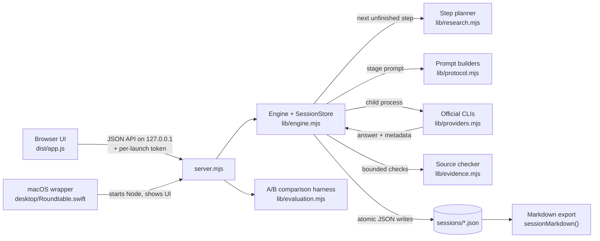

# Engineering notes

Current snapshot: prepared 2026-10-19, revised 2026-10-20 (Taiwan time) · source version 0.6.0 · work in progress. Paths are relative to the repository root. "Implemented" below means present in the source; it does not mean exercised against live model tools for this snapshot.

## 1. Data flow and where to look

| Concern | Location |
|---|---|
| HTTP API; Host/Origin checks, per-launch token, CSP, one generation at a time | `server.mjs` |
| Step list, follow-up planning, resume rule | `lib/research.mjs` — `baseSteps`, `buildVerificationPlan`, `basisFor`, `stepComplete` |
| Stage prompts and Markdown export | `lib/protocol.mjs` — `initialPrompt`, `critiquePrompt`, `verificationPrompt`, `synthesisPrompt`, `sessionMarkdown` |
| Execution loop, pause/failure states, source-check scheduling | `lib/engine.mjs` — `Engine.execute`, `retrieveSources`, `cancel` |
| CLI discovery, flags, response parsing, timeouts | `lib/providers.mjs` — `discoverBinary`, `invocation`, `parseResponse`, `runProcess`, `callProvider` |
| Read-only diagnostics, error classes, redaction | `lib/diagnostics.mjs` |
| Claim/source/issue parsing and grouping | `lib/research.mjs` — `parseResearch`, `analysisFor`; `lib/review.mjs` |
| HTTPS retrieval guardrails, Crossref lookup, quote matching | `lib/evidence.mjs` — `validateSourceURL`, `createSafeFetcher`, `createSourceChecker` |
| Pre-research clarification (no model call) | `lib/clarification.mjs` |
| Masked A/B comparison, ratings, export | `lib/evaluation.mjs`, `data/evaluation-suite.json` |

## 2. What each stage can see

| Stage | Who | Prompt contains | Web search |
|---|---|---|---|
| Clarification | local code | asks at most two questions (goal, constraints) only if missing; skipped answers become stated assumptions | no model call |
| Independent | each participant | question, decision context, user material, optional background packet | on |
| Critique (skipped at overview depth) | each participant | the above + every saved first-round answer (not other critiques) | off |
| Follow-up check (`verification` in code; 0/1/2 by depth) | participants in rotation | the above + first-round answers, critiques and the targeted unresolved issues | on |
| Synthesis | chair | the above + all saved non-synthesis answers, local source-check records and the issue catalog | off |

The mocked example measures this from the real prompts: [`examples/mock-roundtable/output/stage-inputs.md`](../examples/mock-roundtable/output/stage-inputs.md). Separating what each stage sees is information flow, not statistical independence — real participants may share training data, web sources and the same background packet.

## 3. Engineering trade-offs

**Official CLIs with subscription sign-in instead of API keys.** *Why:* uses accounts the user already has, the app stores no API keys, and accidental API billing is guarded against — API-key variables are removed from the child environment, sign-in is checked before each Codex/Claude request, and API or extra-credit configurations stop the run. *Cost:* the adapters depend on third-party CLI flags and JSON event formats that can change (diagnostics read `--help` to detect missing flags); usage units differ by vendor; the model that actually answered is known only when the CLI reports it in metadata, so requested settings are stored separately from observed models. The Antigravity CLI takes the prompt as a command-line argument, so prompts are capped at 100 KB and briefly appear in the process list (for example to `ps` under the same account); the other two adapters use stdin.

**Step-level persistence keyed to inputs.** *Why:* every answer is saved immediately (temporary file + rename, mode 0600) together with a record of the inputs it was built from (the question, or the IDs of the earlier answers). Pausing, a crash or a failed request leaves completed steps intact; resuming re-runs only steps whose inputs changed or that never finished, and failures end as `paused` or `failed`, never `complete`. *Cost:* more disk writes and more complex completion logic; an imported answer marks earlier syntheses stale, so a resume can trigger new calls; a failed request may still have consumed usage.

**Mechanical source checks kept apart from model judgments.** *Why:* model-written annotations (claims, sources, issue status) are stored as model assessments, while retrieval records come only from program code. The checker accepts HTTPS on port 443 only, blocks private/reserved addresses, pins the resolved address, allows ≤3 re-validated redirects, 12 s and 1 MB, and never executes page scripts. *Cost:* coverage is deliberately partial (1/3/5 citations by depth, before and after synthesis); many papers yield only metadata or an abstract; PDF and compressed responses are unsupported; a quote mismatch does not show that a claim is false.

## 4. Evidence and checks

| Layer | What exists | Limits |
|---|---|---|
| Source review (2026-10-19) | `server.mjs`, every `lib/` module, the tests and the Swift wrapper were read; `dist/app.js` was scanned, not read in full. The 22 code/data files are byte-identical (SHA-256) to the 0.6.0 working copy and unchanged in the revision | Reading code is not running it |
| Test runs (2026-10-19, first snapshot) | `npm test` (run as `node --test tests/*.test.mjs`): the same 35-test suite was run three times — on the copied source, on the assembled snapshot and on the extracted archive — with 35 passed, 0 failed each time. The runs used a copy in a Linux execution environment (Node 22.23.2), inside network namespaces created with `unshare -rn`, which start with only a loopback interface; the interface listing that shows this was taken in a separate namespace of the same kind, not during the test runs themselves. A minimal `PATH` and a temporary `HOME` kept vendor tools out of program discovery; that is not a network control | Mocked runners only; Linux, not the macOS app; not re-run for the revision; full logs not kept |
| Mock example (2026-10-20 revision) | Regenerated once at 2026-10-19 18:02 UTC in a fresh network namespace with only a loopback interface and no routes: 6 mocked calls, 4 mocked source checks plus 1 reuse, the same counts as in the first snapshot | Fixed synthetic fixtures; no live model or CLI |
| Historical build notes (not included) | 0.6.0 upgrade notes record 35 tests on bundled Node 24 and system Node 25 (the saved log shows 35 passed), 0 real model calls, and that 0.5.0's 156-test suite was not re-run | Notes and log are undated |
| Historical live run (private, not included) | One session from an earlier version, 2026-09-20, marked complete: three platforms × first round and critique, plus a Codex synthesis, none imported | Program version and responding model IDs not recorded |
| Not done | Swift build, macOS app launch, UI rendering check, manual `npm start`, live CLI calls, source checks against live websites, answer-quality evaluation | — |

## 5. Known gaps and unevaluated effects

- No A/B comparison has been run with real tools, and no human ratings exist. Nothing shows better accuracy, fewer hallucinations or time savings than a single model.
- The comparison harness masks platform names until reveal, but answer text can still reveal its origin, and the roundtable arm makes more calls; it is not a double-blind study.
- Gemini participation is off by default. Its readiness comes from an explicit diagnostic (model listing) or connection test in the current server session; per-request checks only confirm that API or extra-credit settings are off.
- Desktop packaging relied on an existing installed app bundle (Node runtime, a vendor CLI, icon); that packaging script and those binaries are not included. The Swift wrapper is included for reference only.
- Local single-user design: the token protects against cross-site requests, not other local users; session files are unencrypted JSON (mode 0600).
- Tests cover software behavior with mocks; there is no end-to-end test against real CLIs and no UI test in this repository.

## 6. External data flows and possible costs

- **Model vendors (via their CLIs):** each prompt can include the question, decision context, pasted context (≤150,000 characters), attachments (≤350,000 characters in total), earlier answers and source-check records. Vendor terms and retention policies apply.
- **Crossref and cited websites:** the checker sends only the DOI or URL being checked, with a fixed User-Agent.
- **Local disk:** `sessions/` (or `ROUNDTABLE_DATA_DIR`), per-step working folders under the runtime directory, and an `evaluations/` folder inside the data folder for comparisons.
- **Usage per run** (primary model calls; retries and vendor-internal calls are extra):

| Depth | n participants | Two participants |
|---|---|---|
| overview | n + 1 | 3 |
| standard | 2n + 1, plus ≤1 follow-up | 5–6 |
| deep | 2n + 1, plus ≤2 follow-ups | 5–7 |

A single-model baseline uses 2 calls (answer, then synthesis after source checks). In the comparison harness, price and remaining quota are recorded as unknown (null), never as zero.

## 7. Updating this showcase

Development continues in a private working folder; this repository is a periodic snapshot, not the development location, and it is never synced automatically. To update it: pick a milestone, copy only the selected source files into a new snapshot, re-run `npm test` and the mocked example offline, update the README status line, capability list and validation table, and review the file list for private data. Never copy `sessions/`, runtime folders, logs, app bundles or vendor binaries. A first public commit can be described as the current snapshot; it does not reconstruct earlier development history.

For this snapshot, `README.md`, `docs/`, `examples/`, `.gitignore`, `THIRD_PARTY_NOTICES.md` and `licenses/` were added. Left out from the working copy: an internal README, the desktop packaging script, a recovered copy of the 0.5.0 wrapper, local session data, build and upgrade logs, app bundles and runtime binaries. No prototype source file was edited; only the example scripts under `examples/` were revised in the 2026-10-20 revision.

## 8. Third-party material

- `lib/evidence.mjs` embeds the HTML named-character-reference table, exported (per its source comment) from Python's `html.entities`, which is generated from the WHATWG HTML Standard. Its origin, a comparison with Python's dictionary and both upstream notices are in [`THIRD_PARTY_NOTICES.md`](../THIRD_PARTY_NOTICES.md); the Python version used for the export was not recorded.
- `data/research-brief.json` is an AI-assistant-prepared background packet (as of 2026-09-20) listing ten public sources by title, URL, date and publisher, with short paraphrased summaries and limitations. It is example input for the optional background packet; it was not re-verified for this snapshot and is not the author's finding. Linked documents belong to their publishers.
- `data/evaluation-suite.json` contains six bilingual questions written for this project (as of 2026-10-02); they contain no personal data.
- Codex, Claude Code and Antigravity are third-party tools that users install themselves; their terms apply. Node.js is a required runtime and is not included.
- `tests/diagnostics.test.mjs` contains fake secret-like strings and `example.org` addresses used to test redaction; they are not real credentials.
